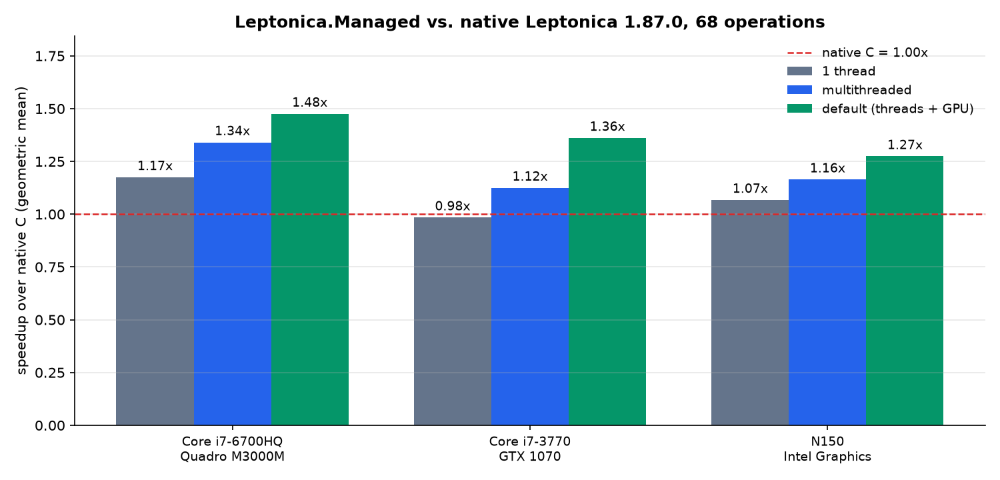
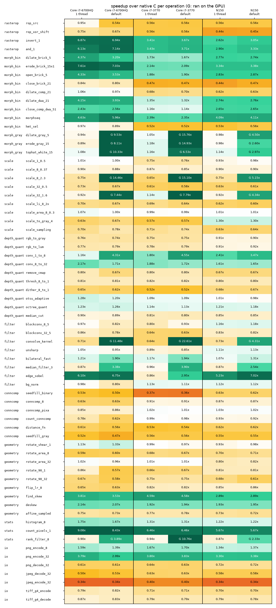

# Benchmarks

Leptonica.Managed compared with the native Leptonica 1.87.0 library on the same machine and
the same inputs. The numbers are speedups `T(native) / T(managed)` of the median time of
each operation; above 1.00 the managed code is faster. Generated by `benchmarks/report.py`.

- **native**: the C library, Release build (MSVC x64, codecs from vcpkg), one thread.
- **1 thread**: Leptonica.Managed with one thread and no GPU, the same work as the C library.
- **multithreaded**: all CPU cores, no GPU.
- **default**: what an application gets without any configuration: all cores, and the GPU
  for the operations that have GPU kernels when a GPU is present.

## Machines

| CPU | GPU | OS | 1 thread | multithreaded | default (threads + GPU) |
|---|---|---|---:|---:|---:|
| Core i7-6700HQ | Quadro M3000M | Microsoft Windows 10 Pro (10.0.19045, Build 19045) | 1.17x | 1.34x | 1.48x |
| Core i7-3770 | GTX 1070 | Microsoft Windows 10 Enterprise (10.0.18363, Build 18363) | 0.98x | 1.12x | 1.36x |
| N150 | Intel Graphics | Microsoft Windows 11 Pro (10.0.26300, Build 26300) | 1.07x | 1.16x | 1.27x |

## Operations

| operation | C function | Core i7-6700HQ: native ms / 1 thread / default | Core i7-3770: native ms / 1 thread / default | N150: native ms / 1 thread / default |
|---|---|---|---|---|
| `rop_src` | `pixRasterop` | 0.204 / 0.95x / 0.54x | 0.151 / 0.56x / 0.56x | 0.121 / 0.56x / 0.56x |
| `rop_xor_shift` | `pixRasterop` | 0.395 / 0.75x / 0.67x | 0.332 / 0.56x / 0.56x | 0.259 / 0.44x / 0.45x |
| `invert_1` | `pixInvert` | 0.749 / 6.87x / 6.94x | 0.539 / 3.41x / 3.67x | 0.430 / 2.62x / 3.05x |
| `and_1` | `pixAnd` | 0.785 / 6.13x / 7.14x | 0.556 / 3.43x / 3.71x | 0.490 / 2.90x / 3.33x |
| `dilate_brick_5` | `pixDilateBrick` | 3.642 / 4.37x / 3.20x | 2.660 / 1.73x / 1.67x | 2.478 / 2.77x / 2.74x |
| `erode_brick_15x1` | `pixErodeBrick` | 7.012 / 7.61x / 7.03x | 5.040 / 2.14x / 2.09x | 4.048 / 3.34x / 3.38x |
| `open_brick_5` | `pixOpenBrick` | 5.837 / 4.33x / 3.53x | 4.480 / 1.88x / 1.90x | 3.846 / 2.83x / 2.87x |
| `close_brick_21` | `pixCloseBrick` | 22.439 / 0.84x / 0.80x | 16.930 / 0.47x / 0.47x | 14.485 / 0.44x / 0.47x |
| `dilate_comp_21` | `pixDilateCompBrick` | 7.053 / 1.06x / 0.97x | 5.957 / 0.68x / 0.70x | 5.502 / 0.62x / 0.63x |
| `dilate_dwa_21` | `pixDilateBrickDwa` | 6.806 / 4.15x / 3.93x | 6.787 / 1.35x / 1.32x | 5.161 / 2.74x / 2.76x |
| `close_comp_dwa_51` | `pixCloseCompBrickDwa` | 8.076 / 2.43x / 2.56x | 7.667 / 1.16x / 1.14x | 6.253 / 2.65x / 2.65x |
| `morphseq` | `pixMorphSequence` | 29.400 / 4.63x / 5.96x | 24.029 / 2.39x / 2.35x | 19.555 / 4.09x / 4.11x |
| `hmt_sel` | `pixHMT` | 3.496 / 0.97x / 0.89x | 2.543 / 0.52x / 0.52x | 2.168 / 0.53x / 0.56x |
| `dilate_gray_5` | `pixDilateGray` | 9.033 / 0.94x / 9.53x (GPU) | 8.886 / 1.05x / 15.76x (GPU) | 8.307 / 0.98x / 4.50x (GPU) |
| `erode_gray_15` | `pixErodeGray` | 8.920 / 0.89x / 8.11x (GPU) | 9.660 / 1.18x / 14.93x (GPU) | 7.889 / 0.98x / 2.60x (GPU) |
| `tophat_white_15` | `pixTophat` | 19.786 / 1.08x / 10.33x (GPU) | 20.541 / 1.16x / 6.53x (GPU) | 16.897 / 1.14x / 2.97x (GPU) |
| `scale_1_0.5` | `pixScale` | 5.001 / 1.01x / 1.00x | 4.293 / 0.75x / 0.76x | 4.324 / 0.93x / 0.98x |
| `scale_8_0.37` | `pixScale` | 1.046 / 0.90x / 0.88x | 0.976 / 0.87x / 0.85x | 0.838 / 0.90x / 0.90x |
| `scale_8_2.3` | `pixScale` | 7.315 / 0.75x / 14.46x (GPU) | 7.066 / 0.65x / 15.10x (GPU) | 6.843 / 0.75x / 5.15x (GPU) |
| `scale_32_0.5` | `pixScale` | 1.988 / 0.73x / 0.67x | 1.788 / 0.61x / 0.58x | 1.425 / 0.63x / 0.61x |
| `scale_32_1.6` | `pixScale` | 7.259 / 0.92x / 7.44x (GPU) | 7.568 / 1.14x / 7.79x (GPU) | 6.680 / 0.92x / 4.34x (GPU) |
| `scale_li_8_2x` | `pixScaleGrayLI` | 0.442 / 0.70x / 0.67x | 0.393 / 0.69x / 0.64x | 0.398 / 0.62x / 0.60x |
| `scale_area_8_0.3` | `pixScaleAreaMap` | 0.675 / 1.07x / 1.00x | 0.608 / 0.99x / 0.99x | 0.547 / 1.01x / 1.01x |
| `scale_to_gray_4` | `pixScaleToGray4` | 0.932 / 0.63x / 0.67x | 0.883 / 0.57x / 0.57x | 1.677 / 1.30x / 1.30x |
| `scale_sampling` | `pixScaleBySampling` | 0.101 / 0.70x / 0.78x | 0.097 / 0.71x / 0.74x | 0.113 / 0.63x / 0.64x |
| `rgb_to_gray` | `pixConvertRGBToGray` | 0.786 / 0.76x / 0.74x | 0.760 / 0.75x / 0.75x | 0.548 / 0.91x / 0.90x |
| `rgb_to_lum` | `pixConvertRGBToLuminance` | 0.778 / 0.77x / 0.79x | 0.760 / 0.78x / 0.79x | 0.548 / 0.91x / 0.92x |
| `conv_1_to_8` | `pixConvert1To8` | 5.140 / 1.16x / 4.31x | 5.652 / 1.80x / 4.55x | 4.423 / 2.41x / 3.47x |
| `conv_8_to_32` | `pixConvert8To32` | 0.193 / 2.17x / 1.71x | 0.211 / 1.88x / 1.72x | 0.211 / 1.61x / 1.65x |
| `remove_cmap` | `pixRemoveColormap` | 0.004 / 0.80x / 0.67x | 0.004 / 0.80x / 0.80x | 0.004 / 0.67x / 0.67x |
| `thresh_8_to_1` | `pixThresholdToBinary` | 0.135 / 0.81x / 0.81x | 0.125 / 0.82x / 0.82x | 0.124 / 0.80x / 0.80x |
| `dither_8_to_1` | `pixDitherToBinary` | 1.316 / 0.65x / 0.62x | 1.239 / 0.52x / 0.52x | 1.258 / 0.68x / 0.67x |
| `otsu_adaptive` | `pixOtsuAdaptiveThreshold` | 1.066 / 1.28x / 1.20x | 0.876 / 1.09x / 1.09x | 0.891 / 1.01x / 0.98x |
| `octree_quant` | `pixOctreeColorQuant` | 8.168 / 1.23x / 1.26x | 7.127 / 1.14x / 1.13x | 6.762 / 1.21x / 1.18x |
| `median_cut` | `pixMedianCutQuant` | 4.099 / 0.90x / 0.89x | 3.682 / 0.81x / 0.80x | 3.208 / 0.85x / 0.85x |
| `blockconv_8_5` | `pixBlockconv` | 1.013 / 0.97x / 0.82x | 1.013 / 0.80x / 0.93x | 0.904 / 1.16x / 1.18x |
| `blockconv_32_5` | `pixBlockconv` | 5.633 / 0.86x / 0.78x | 4.631 / 0.64x / 0.63x | 4.643 / 0.83x / 0.82x |
| `convolve_kernel` | `pixConvolve` | 13.735 / 0.71x / 11.48x (GPU) | 11.805 / 0.64x / 22.61x (GPU) | 11.239 / 0.73x / 4.31x (GPU) |
| `unsharp` | `pixUnsharpMasking` | 8.898 / 1.05x / 0.95x | 8.321 / 0.89x / 0.85x | 7.837 / 1.11x / 1.13x |
| `bilateral_fast` | `pixBilateral` | 808.521 / 1.21x / 1.90x | 706.111 / 1.17x / 1.94x | 2076.312 / 1.07x / 1.31x |
| `median_filter_3` | `pixMedianFilter` | 7.612 / 0.87x / 3.38x | 7.917 / 0.96x / 3.90x | 7.413 / 0.87x / 2.54x |
| `edge_sobel` | `pixSobelEdgeFilter` | 2.051 / 6.10x / 6.75x | 1.844 / 0.86x / 2.95x | 1.805 / 5.23x / 7.02x |
| `bg_norm` | `pixBackgroundNormSimple` | 2.077 / 0.98x / 0.80x | 2.125 / 1.13x / 1.11x | 1.888 / 1.12x / 1.12x |
| `seedfill_binary` | `pixSeedfillBinary` | 3.898 / 0.53x / 0.50x | 3.390 / 0.37x / 0.36x | 4.797 / 0.63x / 0.62x |
| `conncomp_8` | `pixConnComp` | 13.627 / 0.63x / 0.63x | 12.552 / 0.91x / 0.91x | 11.217 / 0.87x / 0.87x |
| `conncomp_pixa` | `pixConnComp` | 22.601 / 0.85x / 0.86x | 18.387 / 1.02x / 1.01x | 16.208 / 1.03x / 1.02x |
| `count_conncomp` | `pixCountConnComp` | 13.451 / 0.78x / 0.62x | 12.707 / 0.99x / 0.98x | 11.233 / 0.93x / 0.92x |
| `distance_fn` | `pixDistanceFunction` | 38.457 / 0.61x / 0.56x | 36.422 / 0.53x / 0.54x | 38.132 / 0.62x / 0.62x |
| `seedfill_gray` | `pixSeedfillGray` | 64.355 / 0.52x / 0.47x | 73.655 / 0.56x / 0.56x | 61.595 / 0.55x / 0.55x |
| `rotate_shear_1` | `pixRotate` | 4.461 / 1.13x / 1.33x | 3.172 / 0.99x / 0.97x | 2.209 / 0.93x / 0.98x |
| `rotate_area_8` | `pixRotate` | 1.942 / 0.59x / 0.60x | 1.874 / 0.68x / 0.67x | 1.660 / 0.70x / 0.71x |
| `rotate_area_32` | `pixRotate` | 4.004 / 1.02x / 0.96x | 3.545 / 1.01x / 1.01x | 3.439 / 0.80x / 0.82x |
| `rotate_90_1` | `pixRotate90` | 6.662 / 0.86x / 0.57x | 5.767 / 0.66x / 0.67x | 5.863 / 0.81x / 0.81x |
| `rotate_90_32` | `pixRotate90` | 0.250 / 0.67x / 0.58x | 0.268 / 0.75x / 0.75x | 0.305 / 0.68x / 0.61x |
| `flip_lr_8` | `pixFlipLR` | 0.262 / 0.65x / 0.63x | 0.275 / 0.82x / 0.82x | 0.268 / 0.85x / 0.86x |
| `find_skew` | `pixFindSkew` | 9.361 / 3.81x / 3.53x | 12.279 / 4.59x / 4.58x | 7.527 / 2.89x / 2.89x |
| `deskew` | `pixDeskew` | 12.752 / 2.14x / 2.07x | 10.644 / 1.92x / 1.94x | 9.394 / 1.93x / 1.95x |
| `affine_sampled` | `pixAffineSampledPta` | 1.258 / 0.75x / 0.73x | 1.211 / 0.77x / 0.78x | 0.789 / 0.73x / 0.72x |
| `histogram_8` | `pixGetGrayHistogram` | 0.736 / 1.75x / 1.67x | 0.519 / 1.31x / 1.31x | 0.569 / 1.22x / 1.22x |
| `count_pixels_1` | `pixCountPixels` | 0.472 / 9.08x / 8.43x | 0.433 / 6.46x / 6.46x | 0.414 / 5.67x / 5.67x |
| `rank_filter_8` | `pixRankFilterGray` | 8.933 / 0.90x / 3.89x (GPU) | 9.369 / 0.94x / 10.76x (GPU) | 8.678 / 0.87x / 2.33x (GPU) |
| `png_encode_8` | `pixWriteMem` | 9.365 / 1.59x / 1.39x | 8.584 / 1.67x / 1.70x | 8.742 / 1.34x / 1.37x |
| `png_encode_32` | `pixWriteMem` | 91.236 / 3.79x / 2.99x | 80.293 / 3.80x / 3.83x | 89.639 / 3.30x / 3.38x |
| `png_decode_32` | `pixReadMem` | 5.720 / 0.61x / 0.61x | 5.087 / 0.64x / 0.63x | 5.898 / 0.72x / 0.72x |
| `jpeg_decode_32` | `pixReadMem` | 2.799 / 0.50x / 0.53x | 3.194 / 0.63x / 0.63x | 2.719 / 0.58x / 0.58x |
| `jpeg_encode_32` | `pixWriteMem` | 2.983 / 0.34x / 0.34x | 3.244 / 0.40x / 0.40x | 2.647 / 0.34x / 0.34x |
| `tiff_g4_encode` | `pixWriteMem` | 15.222 / 0.79x / 0.82x | 12.775 / 0.71x / 0.71x | 12.347 / 0.70x / 0.70x |
| `tiff_g4_decode` | `pixReadMem` | 7.762 / 0.87x / 0.83x | 6.265 / 0.79x / 0.79x | 6.257 / 0.79x / 0.78x |
