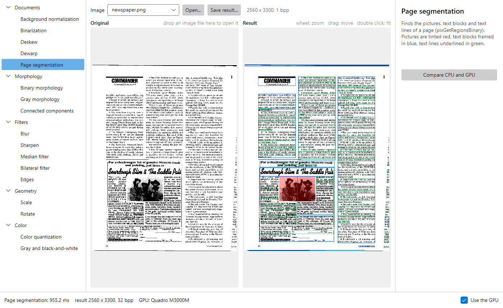
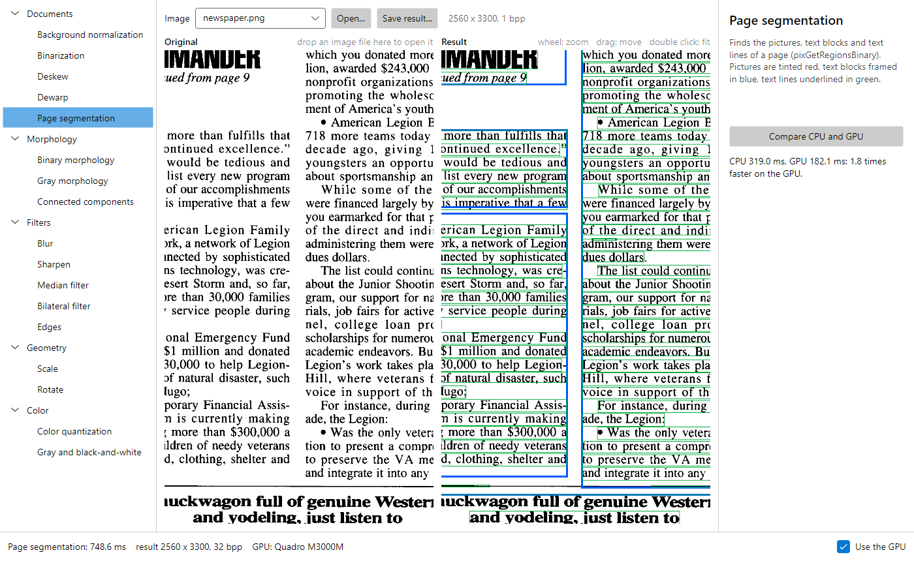
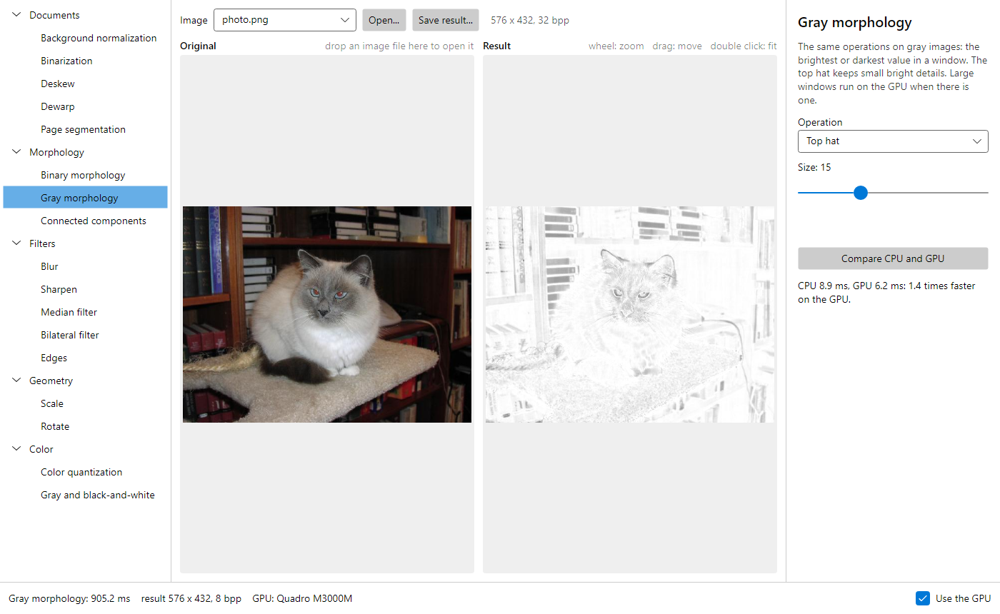

# Samples

Small programs that show how to use [Leptonica.Managed](https://www.nuget.org/packages/Leptonica.Managed).
They reference the NuGet package, target .NET 8, and open in Visual Studio 2022 or later, in VS Code
(C# Dev Kit) and in Rider: open `Leptonica.Managed.Samples.sln`, or run any of them from this folder:

```
dotnet run --project OcrPipeline
```

The input images in [images](images) are test images of the Leptonica library. Every console
sample writes its results into an `output` folder in the current directory and prints the time
of each step.

| Sample | What it shows |
|---|---|
| [Explorer](Explorer) | Desktop application (Windows, Linux, macOS): seventeen operations with their parameters, the original and the result side by side with synchronized zoom and pan, the time of each run, a CPU and GPU comparison, drag and drop of image files. |
| [OcrPipeline](OcrPipeline) | Preparing a scanned page for OCR: gray, background normalization, deskew, threshold, noise removal. |
| [WebApi](WebApi) | An ASP.NET Core service with the pipeline behind a service in the dependency injection container: settings from `appsettings.json`, GPU start-up at server start, limited concurrency, problem details for bad input. `WebApi.http` has ready requests. |
| [PageLayout](PageLayout) | Page segmentation of a newspaper page: pictures, text blocks and text lines, drawn over the page. |
| [Dewarp](Dewarp) | Straightening the curved lines of a photographed book page. |
| [ScansToPdf](ScansToPdf) | Cleaning several scans and writing them into one compact PDF with G4 compression. |
| [ImageBasics](ImageBasics) | Scaling, rotation, sharpening, blur, quantization, morphology, edges, and the image formats. |







## Notes

- **GPU.** Nothing has to be configured: when a CUDA or OpenCL device is present, the operations
  that have GPU kernels use it. Starting the GPU takes about a second once per process, and each
  GPU operation is compiled the first time it runs, so the first run of an operation is slower
  than the next ones. The samples start the GPU at the beginning (`LeptGpu.Warmup()`, or a hosted
  service in WebApi) so that this time is not counted in the steps.
- **The C documentation applies.** `pixDeskew(pixs, 0)` is `pixs.Deskew(0)`, functions with a
  `pixd` argument are static (`Pix.CloseBrick(null, pixs, 21, 1)`), output pointers are `out`
  parameters, constants are in `L` (`L.IFF_PNG`), errors are exceptions.
- **PDF.** Leptonica writes PDF; it cannot read or render PDF files.
- **Showing images in a UI.** [Explorer/PixBitmap.cs](Explorer/PixBitmap.cs) copies the pixels of
  a `Pix` into an Avalonia bitmap without encoding; the same few lines work for SkiaSharp, WPF or
  any library that takes raw BGRA pixels.
